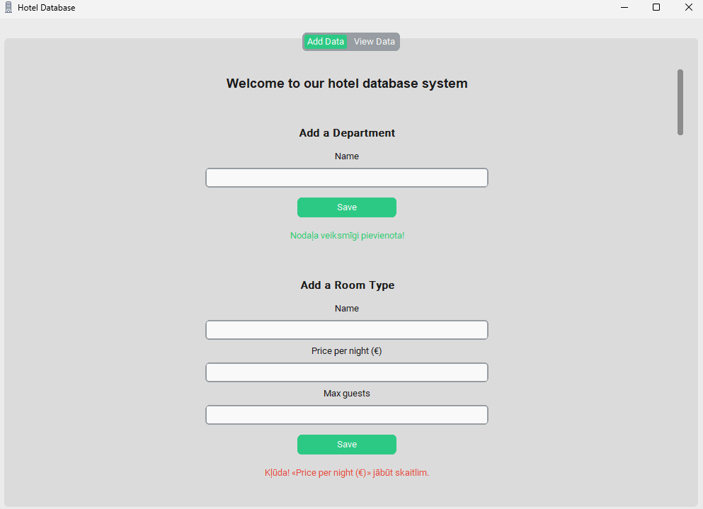
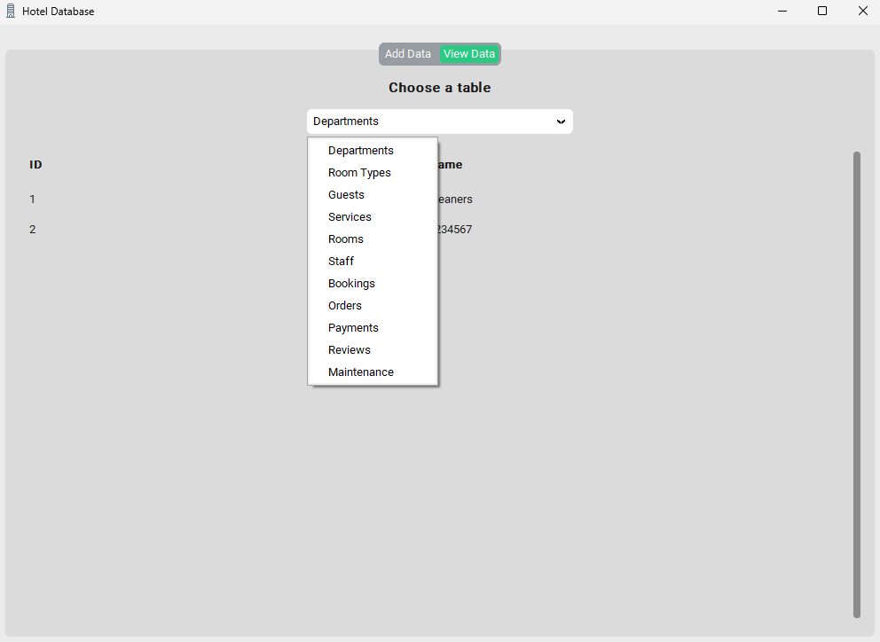
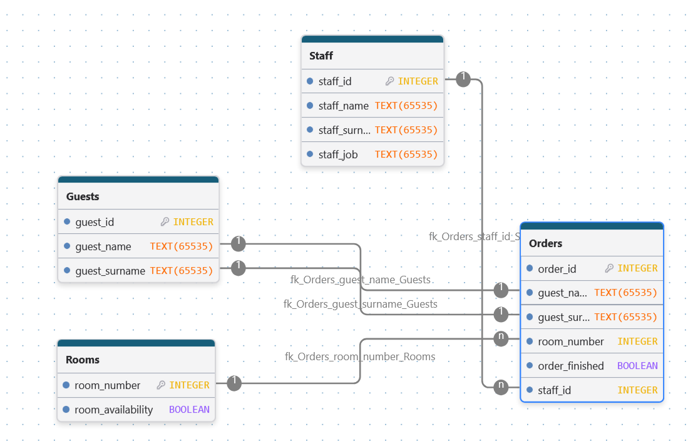

# Hotel Database Application
This application is made to help database employers maintain hotel work.
## Description
Application uses SQL databases for work. 
## Installation
To install, go to the main folder and install app.py and funkcijas.py. Then run app.py.
## Usage
When running the program, you will see the main screen.

Here you can choose what data you would like to see.

## Contributing
If you want to contribute, submit your update suggestions to romanszubenko1@gmail.com
## License
This project is licensed under the MIT License

## Contact
romanszubenko1@gmail.com
* * *
### Additional info
Here is the sketch of the databases of the project.
